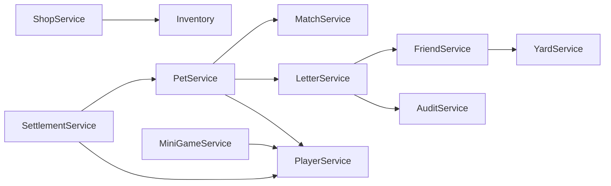

# 02 · 服务端架构（.NET 10 Web API）

> 依据：文档 07（宠物漫游/信件）、10（小游戏）、11（签到）、13（活动）、14（热更结算）、15（目录结构）、16（配置表）
> 代码落位：`server/src/WlidCourt.Api` / `server/src/WlidCourt.Data` / `server/src/WlidCourt.Tests`

## 2.1 项目划分

| 项目 | 职责 | 依赖 |
| --- | --- | --- |
| `WlidCourt.Api` | Web API 宿主：Controller / Service / Job / Hub / Middleware / Utils / Program.cs | WlidCourt.Data |
| `WlidCourt.Data` | EF Core DbContext、实体、迁移 | MySQL 驱动 |
| `WlidCourt.Tests` | 单元/集成测试（匹配、结算、好友、庭院） | Api + Data |

## 2.2 Controllers（REST 入口 ×10）

统一约定：`api/v1/{controller}`；除登录外全部经 `AuthMiddleware` 鉴权；统一返回 `{ code, data, message }` 信封。

| Controller | 职责 | 核心端点 |
| --- | --- | --- |
| `UserController` | 注册/登录、玩家信息、省份城市身份 | `POST /api/v1/user/register`（选省/市）、`POST /api/v1/user/login`、`GET /api/v1/user/profile`、`GET /api/v1/user/level` |
| `PetController` | 宠物信息、派遣、归家 | `GET /api/v1/pet/info`、`POST /api/v1/pet/dispatch`（10 步校验）、`POST /api/v1/pet/recall` |
| `LetterController` | 写信、收信、回赠、审核状态 | `POST /api/v1/letter/send`（50 字 + 随附非遗）、`GET /api/v1/letter/inbox`、`POST /api/v1/letter/gift-back`、`GET /api/v1/letter/status/{letterId}` |
| `FriendController` | 好友、偷菜、喂食、互访 | `POST /api/v1/friend/apply`、`POST /api/v1/friend/accept`、`POST /api/v1/friend/steal`（30% 产量、每日上限）、`POST /api/v1/friend/feed`（3 次/天）、`GET /api/v1/friend/yard/{userId}` |
| `ShopController` | 货架、购买、货币 | `GET /api/v1/shop/shelves`、`POST /api/v1/shop/buy`（庭贝/邮券双货币）、`GET /api/v1/shop/bait-shelf` |
| `YardController` | 庭院布局、容量、互访庭院 | `GET /api/v1/yard`、`PUT /api/v1/yard/layout`（3 个布局槽）、`GET /api/v1/yard/visit/{userId}` |
| `ActivityController` | 活动列表、领取 | `GET /api/v1/activity/list`（Lua 配置）、`POST /api/v1/activity/claim/{activityId}` |
| `DailySignInController` | 签到（复用结算链路，仅读写接口） | `GET /api/v1/signin/today`、`POST /api/v1/signin/claim-week`、`POST /api/v1/signin/claim-month` |
| `MiniGameController` | 小游戏上下限校验、验分 | `POST /api/v1/minigame/start/{gameId}`、`POST /api/v1/minigame/finish`（二次验分）、`GET /api/v1/minigame/daily-cap` |
| `AdminController` | 运营后台：人工审核、公告、封禁 | `POST /api/v1/admin/letter/review`、`GET /api/v1/admin/audit-queue`、`POST /api/v1/admin/ban/{userId}` |

## 2.3 Services（业务逻辑 ×11）

| Service | 职责 | 核心方法（签名级） |
| --- | --- | --- |
| `UserService` | 注册/登录/身份；会话签发 | `Task<User> RegisterAsync(string nickname, int provinceId, int cityId)`；`Task<string> LoginAsync(long userId)`（写 `user_session:{token}`）；`Task<User> GetProfileAsync(long userId)` |
| `PetService` | 宠物属性、状态机（在家→派遣中→休息中→在家）、经验 | `Task<Pet> GetAsync(long petId)`；`Task<DispatchResult> DispatchAsync(long petId, int provinceId, int? cityId, string nonfictionId, string letterContent)`（10 步校验）；`Task SettleReturnAsync(long petId)`（派遣归来：状态+经验+徽章） |
| `MatchService` | 匹配池维护 + 目标选取（Lua 实现权重 60/20/10/10） | `Task<List<long>> FindTargetsAsync(int provinceId, int? cityId, int count)`（对应 `MatchMaker.FindTargets`，Redis ZRevRange + 过滤 + NPC 补位）；`Task RefreshPoolAsync(int provinceId)` |
| `LetterService` | 信件状态机（撰写中→待审核→通过/退回→送达）、回赠、送达 | `Task<long> SendAsync(...)`（入 `letter_audit_queue`）；`Task<List<Letter>> InboxAsync(long userId)`；`Task GiftBackAsync(long letterId, string nonfictionId, string content)`（回赠免审：好友） |
| `FriendService` | 好友申请/接受、偷菜、喂食、加成 | `Task ApplyAsync(long from, long to)`；`Task<StealResult> StealAsync(long userId, long targetUserId, string cropCellId)`（30% 产量、1 次/作物/天、20 次/天、保护罩 24h）；`Task FeedAsync(...)`（3 次/天） |
| `ShopService` | 双货币货架、购买校验、库存 | `Task<List<ShelfItem>> GetShelvesAsync()`；`Task BuyAsync(long userId, string itemId, int count, Currency currency)`（种子 14 / 材料 3 / 道具 / 鱼饵 3） |
| `YardService` | 庭院布局 CRUD、等级容量校验、互访快照 | `Task<Yard> GetAsync(long userId)`；`Task SaveLayoutAsync(long userId, string layoutJson, int slotIndex)`（校验建筑/装饰上限：农田 6→12、槽位 2→5、食物盆 10→20、装饰 50→200、展示柜 3→9、信箱 20→50） |
| `SettlementService` | 每日结算十项（见文档 04 §4.3） | `Task RunDailySettlementAsync(DateTime settleDate)`；`Task RecoverPlayerAsync(long userId, DateTime settleDate)`（宕机/个别失败补算） |
| `MiniGameService` | 小游戏上限校验 + 二次验分 + 奖励 | `Task<StartResult> StartAsync(long userId, string gameId)`；`Task<FinishResult> FinishAsync(long userId, string gameId, int score)`（防作弊：服务端二次验分，记 `transactions(type=minigame)`，评级 S/A/B/C → 庭贝 50/35/20/10，每日上限 200） |
| `PlayerService` | 玩家经验累计/等级计算 | `Task<int> AddExpAsync(long userId, int exp)`（读 `Config_PlayerLevel.json`，等级 1~4 满级 1500 EXP）；`Task<int> GetLevelAsync(long userId)` |
| `AuditService` | 信件三层审核 | `Task AuditAsync(long letterId)`（阿里云 AI → 不确定转人工 → 通过/退回）；`Task HandleReportAsync(long letterId)` |

**Service 间协作**（构造注入，无环）：



## 2.4 Jobs（Quartz 定时任务 ×4）

| Job | 触发 | 职责 |
| --- | --- | --- |
| `DailySettlementJob` | 每日 04:00（UTC+8） | 执行 `SettlementService.RunDailySettlementAsync`（十项，见文档 04 §4.3）；宕机恢复后补跑 |
| `MatchPoolRefreshJob` | 周期刷新（可按 30min 或好客值变更触发） | 按 `hospitality_values:{provinceId}` 重建 `match_pool:{provinceId}` 与 `match_pool:{provinceId}:{cityId}` |
| `ActivityEndJob` | 活动结束时刻 | 关闭活动 + 补发未领奖励（文档 13） |
| `LetterAuditJob` | 消费 `letter_audit_queue` | 逐封调 `AuditService.AuditAsync`（AI→人工→举报三层） |

## 2.5 Hubs（SignalR）

- `ChatHub`：私聊 + 事件推送（新信件、新通知、结算播报）。客户端经 `Net/WebSocket` 连接。

## 2.6 Middleware ×3

| Middleware | 职责 |
| --- | --- |
| `AuthMiddleware` | 解析 token → 校验 `user_session:{token}` → 注入用户上下文；Admin 接口校验运营角色 |
| `LogMiddleware` | 关键操作写 `operation_logs`（user_id/action/details/created_at） |
| `ExceptionMiddleware` | 统一异常 → `{ code, message }`；业务异常与系统异常分级 |

## 2.7 Utils ×4

| Utils | 职责 |
| --- | --- |
| `RedisUtil` | Redis 封装：String / Sorted Set / List 操作，覆盖 8 类 Key |
| `MySqlUtil` | 连接管理 / 事务辅助（与 EF Core 并存） |
| `AliyunAudit` | 阿里云内容安全客户端封装（文字/图片） |
| `TimeUtil` | UTC+8 时间工具、04:00 结算边界计算、跨天判断 |

## 2.8 数据层（WlidCourt.Data）

- `WlidCourtDbContext`：13 张表的 DbSet（users/pets/inventories/yards/letters/friends/nonfiction_collections/badges/transactions/match_pools/operation_logs/daily_settlements/sign_in_records，字段见文档 04）。
- `Entities/`：`UserEntity` / `PetEntity` / `LetterEntity` / `FriendEntity` / `InventoryEntity` / `YardEntity` / `TransactionEntity` 等 1:1 映射。
- `Migrations/`：EF Core 迁移；`scripts/init_db.sql` 提供初始化脚本。

## 2.9 Program.cs 启动编排（目标态）

```
1. 读取 appsettings.{Environment}.json（config/）
2. 注册 DbContext(MySQL) + RedisUtil
3. 注册 Services / Jobs(Quartz) / Hubs(SignalR) / Middleware
4. 启动时：加载 JSON 配置（Config_PlayerLevel.json 等，供 PlayerService/MatchService 使用）
5. 校验 MySQL / Redis 连通性 → 失败快速退出
6. 启动调度器（DailySettlementJob 等 4 个 Job）
```

## 2.10 测试计划（WlidCourt.Tests）

| 测试类 | 覆盖 |
| --- | --- |
| `MatchServiceTests` | 权重排序、城市/省池回退、NPC 补位、不可用过滤 |
| `SettlementServiceTests` | 十项结算、宕机补跑、个别玩家补算 |
| `FriendServiceTests` | 偷菜上限/概率/保护罩、喂食次数 |
| `YardServiceTests` | 布局保存、等级容量校验 |
