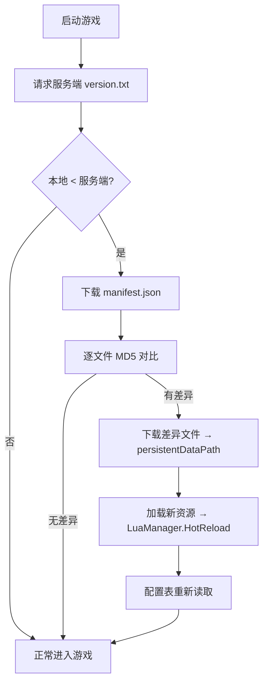

# 03 · 客户端架构（Unity 2022.3.62f3c1 + XLua）

> 依据：文档 03~14 各系统客户端约定、15（目录结构）、16（配置表规范）
> 代码落位：`client/Assets/Scripts` + `client/Assets/LuaScripts`

## 3.1 脚本分层（Assets/Scripts）

| 层 | 目录 | 职责 | 代表文件（目标态） |
| --- | --- | --- | --- |
| 核心 | `Scripts/Core/` | 全局单例、游戏入口、玩家数据、事件总线 | `GameManager.cs`、`PlayerLevel.cs`（玩家经验/等级，读 `Config_PlayerLevel.json`）、`EventBus.cs` |
| 配置 | `Scripts/Core/ConfigMgr.cs` | 加载 `StreamingAssets/config/` 的 JSON（`Config_*.json`），只读缓存供 C#/Lua 查询 | `ConfigMgr.cs` |
| UI | `Scripts/UI/Base/` + 按系统 | 界面基类与各系统界面 | `BasePanel.cs`、`UI/Yard/YardPanel.cs`、`UI/Kitchen/CookingPanel.cs` 等 |
| 玩法 | `Scripts/Gameplay/{系统}/` | 各系统玩法逻辑（见 3.2） | 按系统分目录 |
| 网络 | `Scripts/Net/` | 协议、分发、连接 | `Net/Protocol/`（消息定义）、`Net/Handler/`（消息分发）、`Net/WebSocket/`（SignalR 连接） |
| 工具 | `Scripts/Utils/` | 通用工具 | `TimeUtil.cs`、`JsonUtil.cs`、`MD5Util.cs` |
| Lua 桥 | `Scripts/Lua/` | XLua 宿主、Lua↔C# 绑定、热重载 | `LuaManager.cs`（含 `HotReload()`）、`LuaEnvHolder.cs`、`LuaBehaviour.cs` |

## 3.2 Gameplay 按系统模块（Scripts/Gameplay/）

| 目录 | 对应系统 | 目标职责 |
| --- | --- | --- |
| `Crop/` | 农业生产 | 种地、作物状态（生长/成熟/收获）、钓鱼（鱼饵咬钩率 50/75/95%、出鱼权重） |
| `Processing/` | 加工系统 | 8 条加工配方、产物生成、加工台交互 |
| `Cooking/` | 口粮烹饪 | 烹饪小游戏（火候+盐量 → 品质结算矩阵：极佳/优秀/良好/一般/失败，品质分 5/4/3/2/0）、10 食谱 |
| `Hospitality/` | 好客值 | 好客值面板、公式展示、衰减提示（公式见 05 文档） |
| `Pet/` | 宠物 | 宠物面板、状态机表现、派遣动画、归家日报 |
| `Match/` | 漫游匹配 | 派遣目的地选择、匹配结果展示 |
| `Nonfiction/` | 非遗制作 | 34 省非遗制作（9 种 miniGameType：cut/carve/embroider/weave/paint/shape/brush/assemble/mix）、步骤表现 |
| `Friend/` | 好友 | 好友列表、偷菜、喂食、互访入口 |
| `Shop/` | 商店 | 货架（种子/材料/道具/鱼饵子货架）、双货币（庭贝/邮券） |
| `Yard/` | 庭院建造 | 等轴测 45° 摆放、编辑模式、3 布局槽、互访庭院渲染 |
| `Badge/` | 图鉴徽章 | 非遗图鉴（34 省收集）、徽章护照 |
| `DailySettlement/` | 每日结算 | 结算播报、04:00 推送展示 |

## 3.3 场景流（Assets/Scenes）

```
Launch（启动/热更检查） → ProvinceSelect（省份身份选择） → Main（主界面）
   ├── Yard（庭院主场景）
   ├── Workshop / Kitchen（工坊/厨房）
   ├── Map（派遣地图）
   └── （好友庭院 / 商城 / 图鉴 / 信箱等子场景）
```

## 3.4 热更架构（XLua + AssetBundle，文档 14）

**可热更**：配置表（`StreamingAssets/config/`）、Lua 逻辑（`StreamingAssets/lua/`）、UI 脚本（`lua/UI/`）、活动配置（`lua/Logic/Activity/`）、美术资源（`StreamingAssets/[sprite spine ui]/`）。
**不可热更**：C# 核心代码、引擎修改、新增原生插件 → 重新发包（APK/IPA）。

**启动热更流程：**



**热更失败处理（14.4）：**

| 失败场景 | 处理 |
| --- | --- |
| 下载中断 | 记录进度，下次启动续传 |
| MD5 校验失败 | 删除该文件重新下载 |
| Lua 加载报错 | 自动回滚上一版本 Lua |
| 资源加载失败 | 使用本地缓存旧资源 |
| 连续失败 3 次 | 提示「更新失败，请检查网络」，玩家退出 |

**LuaManager 目标接口：**

```csharp
public class LuaManager : MonoBehaviour {
    public static LuaManager Instance { get; }
    public LuaEnv Env { get; }                       // XLua 全局环境
    public void HotReload();                         // 重载差异 Lua + 重读配置表
    public void DoString(string chunk);
    public T CallFunc<T>(string module, string func, params object[] args);
    public void LoadConfig(string tableName);        // 加载 Config_* 到 C# 缓存
}
```

## 3.5 配置组织：JSON 数值表 + Lua（StreamingAssets/config + Assets/LuaScripts）

| 目录 | 内容 | 示例 |
| --- | --- | --- |
| `StreamingAssets/config/` | 17 张 Excel 导出的 JSON 数值表（`Config_*.json`，ConfigMgr 只读加载） | `Config_PlayerLevel.json` |
| `LuaScripts/Logic/` | 玩法 Lua 逻辑 + 手写 Lua 配置，按系统分目录 | `Activity_MidAutumn.lua`（startTime/endTime/type/content）、`MatchMaker.lua`（`FindTargets`，服务端复用）、`Config_MiniGame.lua`（`MiniGame_List`/`MiniGame_DailyCap`）、`Config_DailySignIn.lua`（`DailySignIn_Week`/`DailySignIn_Month`） |
| `UI/` | UI 绑定逻辑 | 各界面 Lua 控制器 |
| `Localization/` | 多语言/文案 | 信件模板 T01~T05 等 |

**配置表数据流（文档 16）：**

```
Excel（17 张表）
  → Excel2JSON.py 导出校验
  → StreamingAssets/config/（Config_*.json）
  → ConfigMgr 加载（客户端只读缓存）
  → 服务端同步部署同一份 JSON（数值一致）
```

**17 张表清单**（文档 16 §16.1）：Sheet1 Provinces / Sheet2 Cities / Sheet3 Crops / Sheet4 Fish / Sheet4.1 Bait / Sheet5 ProcessRecipes / Sheet6 FoodRecipes / Sheet7 Nonfictions（含 miniGameType + template JSON）/ Sheet8 HospitalityWeights / Sheet9~12 Shop / Sheet13 FriendInteractions / Sheet14 StealMechanics / Sheet15 Badges / Sheet16 YardUnlock / Sheet17 PlayerLevel。

## 3.6 网络层（Scripts/Net）

| 目录 | 职责 |
| --- | --- |
| `Net/Protocol/` | 消息定义（请求/响应 DTO，与服务端 Models 对齐） |
| `Net/Handler/` | 消息分发：按 cmd 路由到对应模块（如 `FriendHandler` → 好友模块） |
| `Net/WebSocket/` | SignalR 长连接：私聊、通知推送、结算播报订阅 |

- HTTP 短连接：REST 业务接口；WebSocket 长连接：实时事件（信件送达、好友申请、通知）。
- 断线重连 + 消息重试；关键请求带幂等键。

## 3.7 客户端本地状态与 UI 解耦

- 服务端为唯一权威；客户端只做表现与本地缓存（如签到 `SignInManager` 只管 UI/本地状态，结算走服务端每日结算链路，不单拆客户端结算逻辑，文档 11 §11.7）。
- UI 数据来源：`EventBus` 事件 + 服务端快照缓存；Lua UI 脚本通过 `LuaBehaviour` 绑定面板生命周期。
