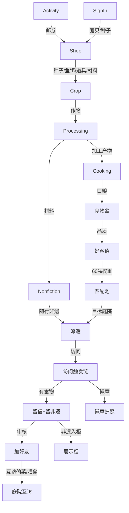
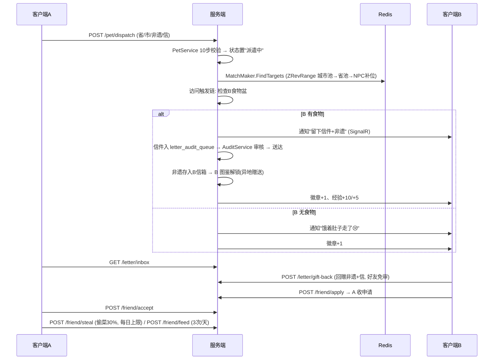

# 05 · 模块依赖与数据流

> 依据：文档 01（主循环）、03（庭院）、04（农业加工）、05（口粮好客值）、07（漫游社交）、08（好友）、09（商店）、13（活动）

## 5.1 核心主循环（完整链路）

```
[种植] 种子(商店/好友/签到, 不可自产) → 14 作物 C01~C14
   │
   ▼
[加工] 8 条配方 → 加工产物(不可售不可购, 用于非遗/赠友/口粮)
   │
   ├──→ [口粮] 10 食谱 + 烹饪小游戏(火候/盐量 → 品质: 极佳5/优秀4/良好3/一般2/失败0)
   │         → 食物盆
   ├──→ [非遗] 34 省 NF01~NF34 制作(9 种 miniGameType) → 背包
   │
   ▼
[好客值] = 200 基础 + 平均品质×50 + 连续招待×10 + 回访+100(3天)
         + 当日在线+150 + 好友+50；衰减: -10/天, 空盆>24h -50, 7日未登录 -100
   │
   ▼
[匹配池] 权重: 好客值60% / 随机20% / 首访10% / 好友10% → match_pool(省/市两级 ZSet)
   │
   ▼
[派遣] 10 步校验(在家/非本省/≥1非遗/≥1口粮/≤50字信) → 宠物状态: 在家→派遣中
   │
   ▼
[访问] 目标庭院: 有食物 → 吃口粮+吐槽+留信+留非遗+徽章
                 无食物 → 不留下+通知+徽章
   │
   ▼
[信件] 撰写中→待审核(阿里云AI→人工→举报)→通过→送达；回赠(好友免审)
   │
   ▼
[好友] 收信触发加好友 → 互访(偷菜 30%/1次作物/天/20次/天 + 保护罩24h; 喂食 3次/天)
   │
   ▼
[图鉴/徽章] 收到异地赠送解锁图鉴(5/10/15/20/25/30/33/34 省里程碑) + 徽章护照
```

## 5.2 跨系统依赖图



## 5.3 关键时序：派遣 → 访问 → 信件 → 好友



## 5.4 经济闭环（防通胀设计）

| 规则 | 依据 |
| --- | --- |
| 加工产物不可出售、不可在商店购买 | 文档 04 §4.9 / 09 §9.5 |
| 种子不可自产，仅商店/好友/签到来源 | 文档 04 §4.3 |
| 商店专属非遗材料仅 3 种（构树皮纸 35 / 金箔 60 / 特殊绣线 45，庭贝） | 文档 09 §9.5 |
| 邮券仅活动产出（跳过 CD、买化肥等） | 文档 09 §9.1.1 / 13 §13.5 |
| 庭贝 45% 出口装饰（回收主渠道） | 文档 09 §9.3 |
| 展示柜货源 = 拜访留下/回赠/回访所得，自制不可入柜 | 文档 07 §7.12 |
| 图鉴仅「收到异地玩家赠送」解锁 | 文档 12 §12.1 |

## 5.5 关键数值公式速查（实现时必须对齐）

| 公式 | 表达式 | 依据 |
| --- | --- | --- |
| 宠物访问数 | `floor((等级+2)/5) + 2`，上限 5 | 文档 07 §7.2 |
| 好客值 | `200 + avg品质×50 + 连续招待×10 + 回访+100(3天) + 在线+150 + 好友+50` | 文档 05 §5.4 |
| 好客值衰减 | 连续未招待 -10/天；空盆>24h -50；7 日未登录 -100 | 文档 05 §5.6 |
| 匹配权重 | 好客值 60% / 随机 20% / 首访 10% / 好友 10% | 文档 07 §7.8 |
| 偷菜 | 30% 产量；1 次/作物/天；20 次/天；保护罩 24h 免疫 | 文档 08 §8.3 |
| 喂食 | 3 次/天；宠物被喂 +2 EXP(上限+10/天) | 文档 08 §8.4 / 07 §7.3 |
| 小游戏评级 | S/A/B/C → 庭贝 50/35/20/10；每日上限 200 | 文档 10 §10.4/10.5 |
| 钓鱼 | 鱼饵 B01~B03 咬钩率 50/75/95%，出鱼权重驱动 | 文档 04 §4.5 |
| 玩家等级 | 1~4 级，满级 1500 EXP，决定庭院容量 | 文档 03 §3.5 / 07 §7.11 |
| 好友加成 | 好客值 +50 / 匹配 +10% / 回赠免审 | 文档 08 §8.5 |

## 5.6 依赖约束（实现红线）

1. 服务端为唯一权威：结算、匹配、发放、防作弊全部服务端判定（文档 10 §10.8、14）。
2. 客户端 Lua 与服务端 Lua 同源同值：数值一致性靠同一套导出配置保证（文档 16）。
3. 活动配置纯 Lua 驱动（startTime/endTime/type/content），服务端到点自动激活/关闭（文档 13）。
4. 签到复用每日结算链路，不单拆 `DailySignInService`（文档 11 §11.7）。
5. 信件三层审核（AI→人工→举报）不可绕过；好友回赠免审为唯一白名单（文档 07 §7.10 / 08 §8.5）。
