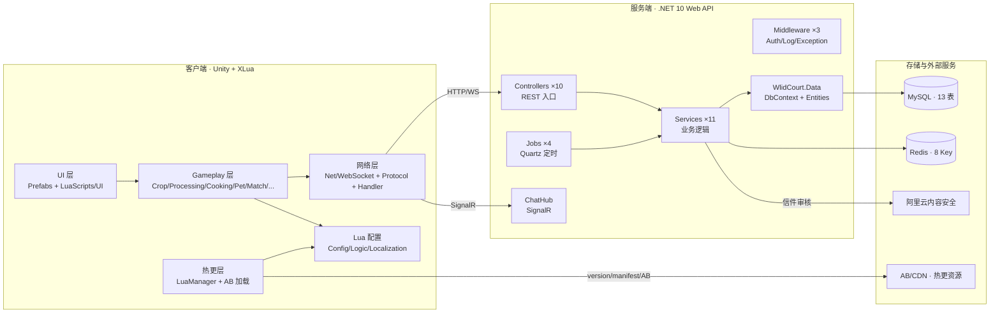
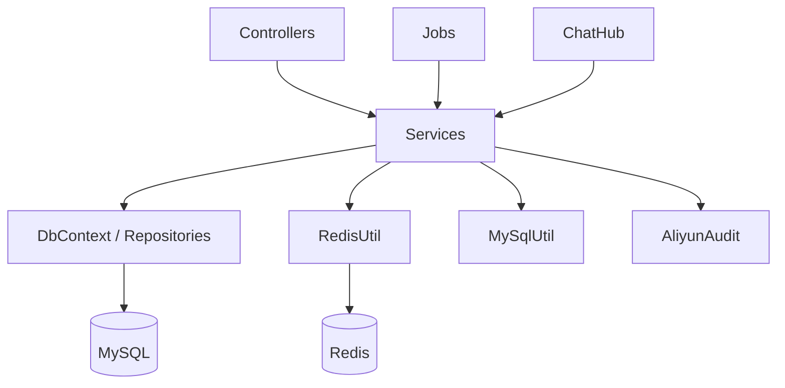

# 01 · 总体架构

> 依据：文档 01（立项）、02（省份身份与地图）、15（目录结构）、16（配置表规范）、17（开发环境与运维）

## 1.1 系统定位

Q 版可爱风 · 全 2D 手绘 · 移动端异步社交手游。玩家在庭院种地、加工、制作非遗、招待来访宠物，派遣宠物携带本省非遗外出拜访异地玩家，逐步形成好友关系与文化收集（34 省非遗图鉴）。

**核心玩法闭环（文档 01 §1.3/1.4）：**

```
种植 → 加工 → (口粮 + 非遗) → 食物盆 → 好客值 → 匹配池 → 派遣
   → 访问 → 留信/留非遗 → 回赠 → 加好友 → 互访(偷菜/喂食) → 图鉴/徽章
```

## 1.2 技术栈

| 层 | 选型 | 说明 |
| --- | --- | --- |
| 客户端引擎 | Unity 2022.3.62f3c1 | 全 2D 手绘（Q 版卡通 + 圆润描边 + 柔和水彩） |
| 客户端热更 | XLua + AssetBundle | 配置表 / Lua 逻辑 / UI 脚本 / 活动配置 / 美术资源可热更 |
| 服务端 | .NET 10 Web API | 三项目：`WlidCourt.Api` / `WlidCourt.Data` / `WlidCourt.Tests` |
| 数据库 | MySQL 8 | 13 张业务表 |
| 缓存 | Redis | 8 类 Key：会话 / 在线状态 / 匹配池 / 结算队列 / 审核队列 |
| 定时调度 | Quartz | 4 个 Job（详见文档 04） |
| 实时通信 | SignalR（ChatHub） | 私聊 / 通知推送 |
| 内容审核 | 阿里云内容安全 + 人工 + 举报 | 信件三层审核 |
| 热更分发 | HTTP（version.txt / manifest.json / AB 文件） | 客户端增量拉取 |

## 1.3 系统分层（C4 系统上下文）



## 1.4 服务端内部依赖（组件级）



- **单向依赖**：Controller → Service → Data/Utils；Job → Service；Hub → Service。禁止反向依赖与环依赖。
- **Service 之间可互相调用**（如 `LetterService` → `FriendService` 触发加好友），通过构造函数注入。
- **Lua 配置服务端复用**：服务端同样读取 Lua 配置（如 `MatchMaker.FindTargets`，文档 07 §7.7），保证客户端/服务端数值一致。

## 1.5 关键设计原则

| 原则 | 落地方式 | 依据 |
| --- | --- | --- |
| 数据驱动 | 所有数值走 Excel → Lua 配置，热更不发版；服务端与客户端同读同一套 Lua | 文档 16 |
| 服务端权威 | 结算/匹配/防作弊/发放一律服务端判定，客户端只做表现与本地缓存 | 文档 10/14 |
| 热更优先 | 配置表、玩法逻辑、活动、UI、美术全部可热更；C# 核心代码才重新发包 | 文档 14 |
| 经济闭环 | 加工产物不可售不可购、种子不可自产、邮券仅活动产出、庭贝 45% 出口装饰 | 文档 04/09/13 |
| 展示柜货源约束 | 仅「拜访留下 / 回赠 / 回访所得」三类他人给予可入柜，自制不可入 | 文档 06/07 |
| 玩家/宠物等级解耦 | 玩家等级（1~4）决定庭院容量；宠物等级（1~20）决定派遣访问数 | 文档 07 §7.11 |

## 1.6 玩家 / 宠物双等级体系

| 维度 | 玩家等级 | 宠物等级 |
| --- | --- | --- |
| 经验来源 | 种地/加工/制作非遗/派遣/签到/小游戏/收信/互访/新手引导 | 派遣归来/留信/被喂食/每日任务/自喂 |
| 等级上限 | 4 级（庭院解锁进度） | 20 级（访问数 = floor((等级+2)/5)+2，上限 5） |
| 配置表 | `Config_PlayerLevel`（Sheet17） | 宠物等级曲线 |
| 客户端 | `PlayerLevel.cs` | 宠物相关脚本 |
| 服务端 | `PlayerService` | `PetService` |

## 1.7 运行环境与运维要点（文档 17）

- 服务端时区统一 **UTC+8**；每日结算固定 **04:00:00** 服务器时间。
- 配置分 `appsettings.Development.json` / `appsettings.Production.json`。
- 脚本：`deploy.sh`、`backup_db.sh`、`hotfix_push.sh`、`init_db.sql`。
- 客户端启动前置：`StreamingAssets/version.txt` 必须存在，否则按缺失版本走全量热更。
